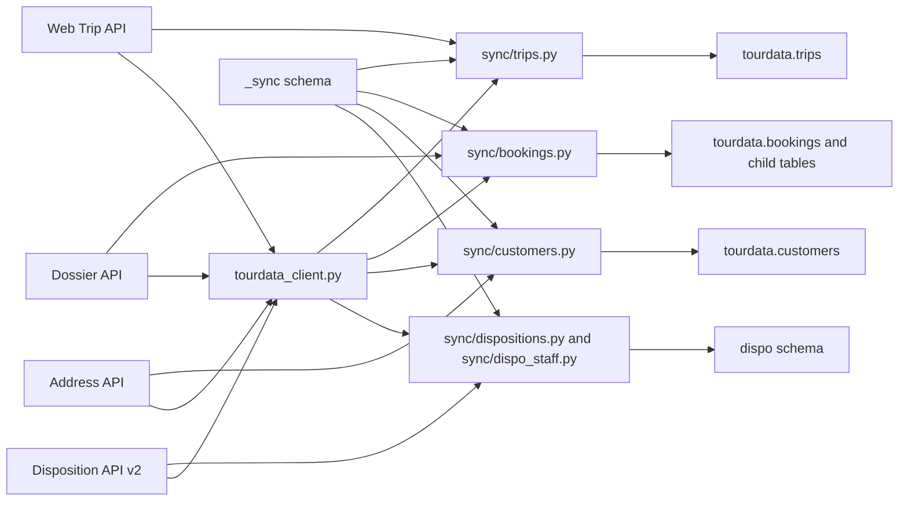

## Übersicht

The TourData Mirror synchronizes data from four upstream TourData APIs into Azure PostgreSQL. Each sync run tracks its entity, status, timestamps, record counts, and source cursor in the `_sync` schema. Syncs are resumable and idempotent: a crash after 10,000 records retains the already-written data and the cursor position reached so far.

## Quellsysteme

| Source             | Client              | Purpose                                    | Sync Module                                    |
| ------------------ | ------------------- | ------------------------------------------ | ---------------------------------------------- |
| Web Trip API       | `WebTripClient`     | Trip catalogue and master data             | `sync/trips.py`                                |
| Dossier API        | `DossierClient`     | Bookings, participants, invoices, services | `sync/bookings.py`                             |
| Disposition API v2 | `DispositionClient` | Vehicles, assignments, drivers, guides     | `sync/dispositions.py` + `sync/dispo_staff.py` |
| Address API        | `AddressClient`     | Reisepersonal and customer addresses       | `sync/customers.py` + `sync/reisepersonal.py`  |

## Sync-State & Cursor-Tracking

The `_sync` schema stores operational state for every synchronization run. Two tables track runs and cursors.

| Table               | Key Fields                                                                                                           | Purpose                                                                |
| ------------------- | -------------------------------------------------------------------------------------------------------------------- | ---------------------------------------------------------------------- |
| `_sync.run`         | `run_id`, `entity`, `status`, `records_upserted`, `last_source_cursor`, `started_at`, `finished_at`, `error_message` | One row per sync execution                                             |
| `_sync.cursor`      | `entity`, `last_source_cursor`, `updated_at`                                                                         | Per-stream resume position                                             |
| `_sync.stream_seen` | `tenant_id`, `stream`, `rows_read`, `rows_changed`                                                                   | Heartbeat: distinguishes "job never ran" from "job ran, found nothing" |

Cursor keys are namespaced per tenant where the upstream API supports mutation cursors. Booking sync uses `bookings:{tenant_id}` as the cursor entity, for example `bookings:twr`. This means all booking runs share the same run-history entity for freshness reporting, while each tenant has an independent source cursor.

The `state.run()` context manager creates a running record, commits it immediately so other processes can see it, yields a tracker, and on success updates the run to `succeeded` with the record count and cursor. On exception, it rolls back business-data writes, marks the run as `failed` with the error message truncated to 2,000 characters, commits the failure record, and re-raises.

## Änderungserkennung

Before writing, every sync module hashes the mapped payload and compares it to the stored hash. This avoids unnecessary writes and suppresses spurious change events.

| Classification | Condition                            | Writes? | Emits Event? |
| -------------- | ------------------------------------ | ------- | ------------ |
| NEW            | No existing row or NULL hash         | Yes     | Yes          |
| BASELINE       | Empty hash or different hash version | Yes     | No           |
| CHANGED        | Different hash, same version         | Yes     | Yes          |
| UNCHANGED      | Same hash                            | No      | No           |

`content_hash()` serializes canonical JSON with sorted keys and returns `<version>:<sha256>`. The version prefix means changing a sync mapping forces a one-time rewrite without treating every row as a business change event. For trips, the hash covers only mirrored columns, not the complete raw response, so volatile source timestamps and unrelated payload fields do not trigger false `trip.changed` events.

`emit_change()` writes to the event outbox in the same database transaction as the business upsert. If the business write rolls back, the event rolls back too. Events contain identifiers and change metadata, never customer PII.

## Trip-Synchronisation

Trip sync enriches trips already present in the mirror. It reads existing trip codes from `tourdata.trips`, fetches summaries and details from the Web Trip API, and upserts the trip with its countries and departure dates.

### API-Endpunkte

| Endpoint                            | Method | Purpose                                                  |
| ----------------------------------- | ------ | -------------------------------------------------------- |
| `GET /trips?codes=...`              | GET    | Summary/master-data rows, paginated via offset/limit     |
| `GET /trip/{code}`                  | GET    | Full detail: departures, programme, hotels, inclusions   |
| `GET /trip/{code}?abTerminstatus=7` | GET    | Additional status-7 departures, merged by departure date |

Trips are processed in chunks of 50. Each trip is committed individually, making the operation resumable: a later failure does not roll back already completed trips.

Departure dates use replacement semantics: existing dates are deleted and re-inserted from the detail response. However, `departure_dates = []` means that the source returned no dates and deletes existing dates, while `departure_dates = None` means that the detail request failed and preserves them. This prevents a failed API call from wiping known departure data.

### Normaler Sync vs. Survey-Backfill

`sync_trips()` reads trip codes from `tourdata.trips`, so it enriches only already-known trips. It does not discover new catalogue trips. `sync_trips_from_surveys()` derives trip codes from `feedback_analytics.survey` and optionally fetches the full Web Trip catalogue with `--with-catalogue`. This mode is used for tenants without booking ingestion or for initial backfills.

<Callout kind="info" collapsed="false">
  Trip sync uses hash version 2, covering only mirrored columns. An unchanged trip is not written, and its child rows, including countries and departure dates, are not touched.
</Callout>

## Booking-Synchronisation

Booking sync ingests dossiers from the Dossier API. It uses a per-tenant `mutationsDatum` cursor for incremental sync, persists the cursor after each successfully processed dossier, and upserts the booking with all child tables.

### API-Endpunkte

| Endpoint                             | Method | Purpose                                                              |
| ------------------------------------ | ------ | -------------------------------------------------------------------- |
| `POST /Login`                        | POST   | Tenant-specific authentication with mandant                          |
| `GET /Dossier/search`                | GET    | Dossier summaries, sorted by mutationsdatum ASC                      |
| `GET /Dossier/{mandant}/{dossierId}` | GET    | Full BuchungDto: bookings, persons, participants, services, invoices |

### Cursor & Suchlogik

The cursor is the maximum `mutationsDatum` seen across processed dossiers, stored under `bookings:{tenant_id}`. The search uses `mutationsDatumVon=<cursor>` and sorts by `mutationsdatum ASC`. After each dossier, the cursor is persisted, so a crash after 10,000 dossiers retains the data and the cursor position.

The Dossier API can fail on certain page sizes. The sync retries with a fallback sequence of page sizes: 100, then 25, then 10. If a search returns no records with an existing cursor, the sync probes forward at increasing intervals, namely 1 minute, 10 minutes, 1 hour, 6 hours, 1 day, 3 days, and 7 days, to work around server-side pagination bugs without permanently getting stuck.

### Child-Tabellen

For each changed booking, the sync deletes and rebuilds child collections: services, which cascade to service items and service-item participants, participants, and invoices. Persons use `ON CONFLICT (person_id) DO UPDATE`, so they are not deleted and person references from other bookings remain stable.

New or changed bookings emit `booking.changed` in the same transaction as the database write. Backfills with `--ignore-cursor` suppress events.

<Callout kind="tip" collapsed="false">
  Use `--ignore-cursor` for absolute backfills. The cursor still advances to the maximum observed `mutationsDatum`, so later incremental runs continue normally.
</Callout>

## Customer-Synchronisation

Customer sync mirrors addresses from the Address API. There is no Address API mutation endpoint, so the work list is derived from customers referenced by bookings.

The sync selects distinct `(customer_mandant, customer_id)` pairs from `tourdata.bookings` that are missing or stale in `tourdata.customers`. With `--stale-days N`, only customers whose `synced_at` is older than N days are selected.

The Address API returns phone numbers, email addresses, interests, and notes. The sync maps only the fields needed by the mirror: salutation, name, address, document-delivery preference, club membership, language, and status. Unnecessary PII is never stored.

Unchanged customers are touched through a lightweight `UPDATE ... SET synced_at = now() WHERE raw_hash = %s` that skips a full address-field rewrite. Only changed or new customers get the full upsert.

## trips-soon: Schnelle Tagesaktualisierung

`sync_trips_soon()` is a fast daytime refresh for trips departing within the next 7 days or currently in progress. It is separate from the full nightly trip sync.

| Aspect              | trips\_soon                                                                 | Nightly sync         |
| ------------------- | --------------------------------------------------------------------------- | -------------------- |
| Selection           | 7-day departure window                                                      | All trips for tenant |
| Frequency           | Frequent, daytime                                                           | Once nightly         |
| Discovers new trips | No                                                                          | No                   |
| Concurrency guard   | Skips if full trips run less than 3h ago or trips\_soon less than 30min ago | No guard             |
| Failure threshold   | Aborts if more than 20% of detail requests fail                             | Per-trip isolation   |

Both paths share the same `_upsert_trip()` function, so day and night produce the identical departure-date view.

## Nightly Azure Function

The timer-triggered Azure Function runs daily at 02:00 UTC. It processes all configured tenants sequentially, with full tenant isolation.

### Per-Tenant-Ausführung

For each tenant, the function:

- Resolves Dossier and Web Trip credentials.
- Skips tenants without credentials and does not abort the run.
- Synchronizes trips first. Trip failures are isolated, logged, and do not stop bookings.
- Synchronizes bookings. Booking failures escalate as a tenant-level error.
- Logs the result per tenant.

### Fehlerpolitik

The function fails visibly only if no tenant completed booking synchronization. This reflects the priority: trips may be unavailable for some tenants, but bookings are the required indicator that useful synchronization occurred.

<Callout kind="alert" collapsed="false">
  The nightly function does not call `sync_customers()`. Customer sync is orchestrated separately as a scheduled Container Apps job.
</Callout>

## Sync-Module

All sync modules live under `src/tourdata_mirror/sync/` and share the same state, cursor, and change-detection infrastructure.

| Module                  | Source API     | Description                                               |
| ----------------------- | -------------- | --------------------------------------------------------- |
| `sync/trips.py`         | Web Trip       | Trip catalogue and trip details                           |
| `sync/trips_soon.py`    | Web Trip       | Fast refresh for imminent and in-progress trips           |
| `sync/bookings.py`      | Dossier        | Bookings, participants, invoices, services, persons       |
| `sync/customers.py`     | Address        | Customer addresses, delivery preferences, club membership |
| `sync/persons.py`       | Address        | Person records from the Address API                       |
| `sync/reisepersonal.py` | Address        | Travel-personnel reconciliation and deactivation          |
| `sync/surveys.py`       | Dossier        | Feedback survey ingestion                                 |
| `sync/dispositions.py`  | Disposition v2 | Raw disposition data ingestion                            |
| `sync/dispo_staff.py`   | Disposition v2 | Disposition personnel and staff                           |
| `sync/dispo_trips.py`   | Disposition v2 | Disposition-to-trip reconciliation                        |
| `sync/changes.py`       | —              | Content hashing, change classification, event emission    |
| `sync/state.py`         | —              | Run tracking, cursor persistence, transaction management  |

## CLI-Befehle

| Command                   | Purpose                                        |
| ------------------------- | ---------------------------------------------- |
| `tdm-backfill trips`      | Enrich existing trips or backfill from surveys |
| `tdm-backfill trips-soon` | Fast refresh for imminent departures           |
| `tdm-backfill bookings`   | Initial or incremental booking sync            |
| `tdm-backfill customers`  | Customer address and club membership sync      |
| `tdm-ingest surveys`      | Feedback survey ingestion                      |
| `tdm-enrich`              | LLM-powered trip recommendations               |
| `tdm-refresh-views`       | Refresh materialized views after sync          |

See the [CLI-Referenz](tourdata-mirror/cli-reference) for all 18 commands with full options and examples.
